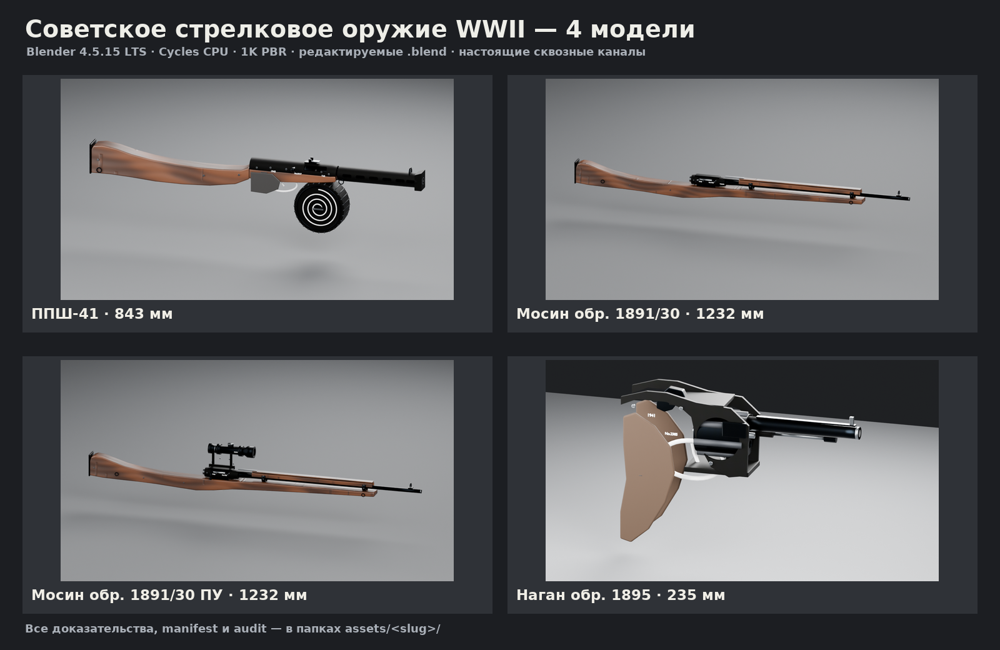

# Отчёт — реалистичные 3D-ассеты советского оружия WWII

Созданы четыре редактируемые high-poly модели в формате `.blend` (Blender 4.5.15 LTS),
с UV, процедурными PBR-текстурами 1K, именованными коллекциями, pivot-контролами,
Cycles-рендерами и скриптовым аудитом. Ветка: `arena/64d1db80-aiwargame`.

## Ассеты

| Модель | Описание | Источник | Hero | Manifest | Audit | Длина X | Треуг. |
|---|---|---|---|---|---|---:|---:|
| ППШ-41 | [ППШ-41 с 71-зарядным барабанным магазином](assets/ppsh-41/README.md) | [.blend](assets/ppsh-41/source/ppsh-41.blend) | [hero](assets/ppsh-41/renders/hero.png) | [manifest](assets/ppsh-41/manifest/asset-manifest.json) | [audit](assets/ppsh-41/audit/audit-report.json) | 843 мм | 58228 |
| Мосин обр. 1891/30 | [Винтовка Мосина обр. 1891/30 с механическим прицелом](assets/mosin-m91-30/README.md) | [.blend](assets/mosin-m91-30/source/mosin-m91-30.blend) | [hero](assets/mosin-m91-30/renders/hero.png) | [manifest](assets/mosin-m91-30/manifest/asset-manifest.json) | [audit](assets/mosin-m91-30/audit/audit-report.json) | 1232 мм | 33672 |
| Мосин обр. 1891/30 ПУ | [Винтовка Мосина обр. 1891/30 с прицелом ПУ 3,5×](assets/mosin-m91-30-pu/README.md) | [.blend](assets/mosin-m91-30-pu/source/mosin-m91-30-pu.blend) | [hero](assets/mosin-m91-30-pu/renders/hero.png) | [manifest](assets/mosin-m91-30-pu/manifest/asset-manifest.json) | [audit](assets/mosin-m91-30-pu/audit/audit-report.json) | 1232 мм | 43476 |
| Наган обр. 1895 | [Револьвер Нагана обр. 1895](assets/nagant-m1895/README.md) | [.blend](assets/nagant-m1895/source/nagant-m1895.blend) | [hero](assets/nagant-m1895/renders/hero.png) | [manifest](assets/nagant-m1895/manifest/asset-manifest.json) | [audit](assets/nagant-m1895/audit/audit-report.json) | 235 мм | 29960 |

## Что входит

- `assets/<slug>/source/<slug>.blend` — активный редактируемый источник.
- `assets/<slug>/textures/` — 30 PBR-карт 1024×1024 (6 наборов × 5 карт).
- `assets/<slug>/renders/` — hero, два боковых силуэта, вид сверху, дульный срез,
  макро канала, clay, turntable GIF и `proofs-index.json`.
- `assets/<slug>/audit/` — конфигурация и отчёт `audit_blend.py` (габариты, трансформации,
  топология, многолучевые проверки полостей).
- `assets/<slug>/manifest/` — `asset-manifest.json` (schema v2) и `build-stats.json`.
- `TASK.md`, `asset-state.md`, `README.md`, `web_refs/sources.md`.

## Ключевые допущения

- ППШ-41: 843 мм, ствол 269 мм, 71-зарядный барабан, поздний деревянный приклад.
- Мосин M91/30: 1232 мм, ствол 730 мм; отдельно рядовая версия и версия с ПУ 3,5×
  (корпус прицела 169 мм, боковой кронштейн).
- Наган M1895: 235 мм, ствол 114 мм, 7-зарядный барабан.
- Метры, Z-up, дуло +X, правая сторона −Y, origin на оси канала у казённого среза.
- 1K-текстуры выбраны как допущение; LOD, collision, риг, анимация и game-ready
  экспорт не заказаны и не выполнялись.

## Проверки

- `python3 scripts/validate_asset.py --root . --strict`
- `python3 scripts/texture_report.py assets --recursive --check`
- `scripts/audit_blend.py` через `scripts/run_blender_tool.py` для каждого `.blend`.
- Все доказательства сгенерированы текущей версией геометрии; отчёты лежат в `reports/`.

## Ограничения и безопасность

Это визуальные активы для рендера/превью. Нет CAD/STEP/STL, чертежей, производственных
допусков, инструкций по сборке или ремонту. Чужие 3D-модели и текстуры не импортировались;
внешние фото использовались только для изучения силуэта и не включены в репозиторий.

## Источники

Подробная таблица URL, вариантов и лицензий — в `assets/*/web_refs/sources.md`.
Основные размеры подтверждены Wikipedia, MuseumOfWeapon, Sniper Central, IWM,
Russian Mosin Nagant, Guns & Ammo, Smithsonian, Modern Firearms и Pritzker Military Museum.
