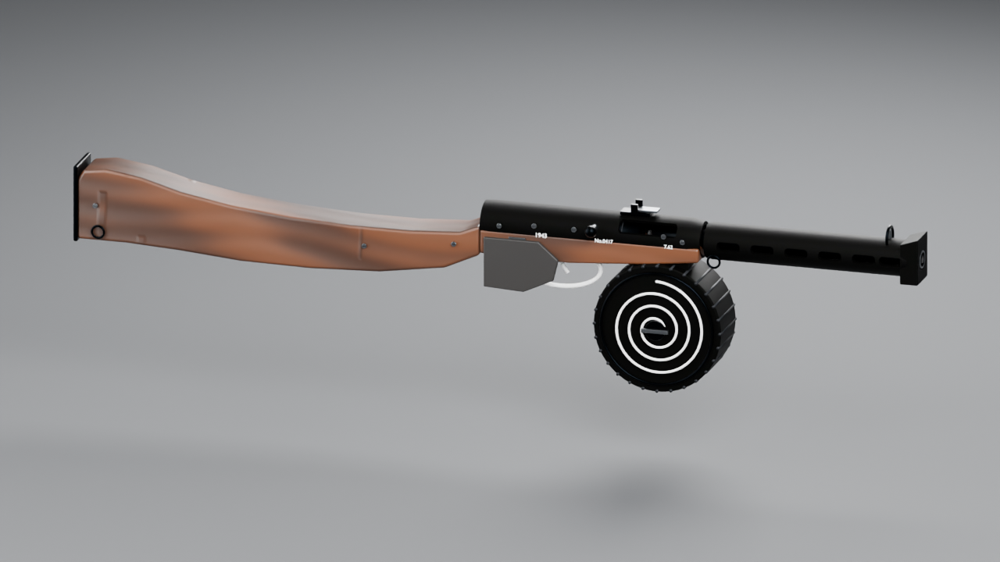

# ППШ-41 — ППШ-41 с 71-зарядным барабанным магазином

Статус: `review` · Архетип: `hard_surface` · Ветка: `arena/64d1db80-aiwargame`

## Состав

| Путь | Что |
|---|---|
| `TASK.md` | контракт задачи и критерии приёмки |
| `asset-state.md` | текущее состояние, размеры, решения, вопросы |
| `web_refs/sources.md` | источники, URL, вариант, лицензия |
| `source/ppsh-41.blend` | редактируемый high-poly источник |
| `textures/` | 30 PBR-карт 1K (6 наборов × 5 карт) |
| `renders/` | hero, силуэты, дульный срез, макро, clay, turntable GIF |
| `audit/` | конфигурация и отчёт скриптового аудита |
| `manifest/` | machine-readable manifest и статистика сборки |
| `exports/` | пусто: game-ready экспорт не заказан |

## Как открыть

Blender 4.5.15 LTS; метры, Z-up. Корневая коллекция `ppsh-41_Model`.
Студийные камера, света и пол лежат в `ppsh-41_Studio`; скрытая 100-мм масштабнаялинейка —
тоже там. Все текстуры лежат рядом с `.blend` по относительному пути `//../textures/`.
Анимации нет; pivot-контролы перечислены в `asset-state.md`.

## Проверки

См. `manifest/asset-manifest.json` (блок `proofs`) и `audit/audit-report.json`.
Каждое изображение в `renders/` закрывает конкретный критерий из `TASK.md`.

## Ограничения

Визуальная модель, а не производственная документация. Game-ready оптимизация,
LOD, collision, риг и анимация не выполнялись.

## Происхождение материалов

Все PBR-карты процедурные и оригинальные. Внешние статьи/музейные страницы
использовались только как справочники; см. `web_refs/sources.md`.
